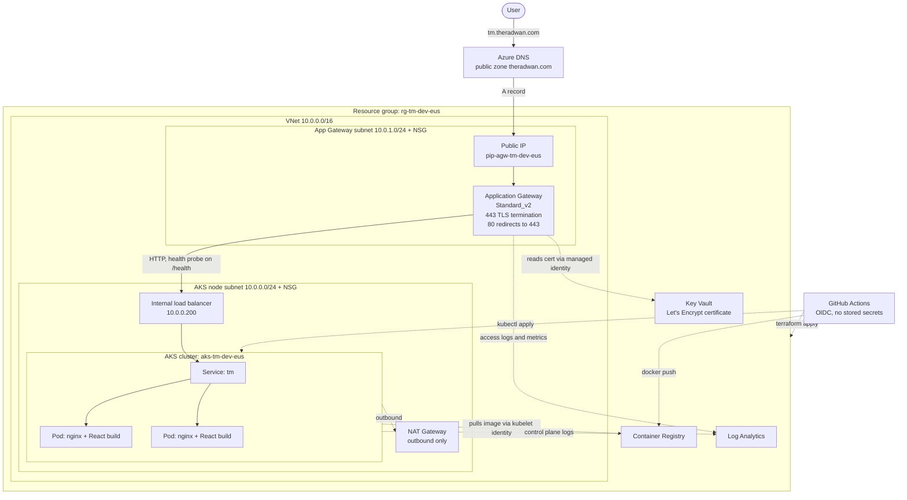

# Threat Composer on Azure Kubernetes Service

A containerised web app running on Azure Kubernetes Service (AKS) behind HTTPS on a custom domain. The infrastructure is written in Terraform, the workload is described in Kubernetes manifests, and both are shipped through GitHub Actions.

**Live URL:** https://tm.theradwan.com (only up while the environment is deployed; it is destroyed between sessions to save cost)

The app is [Threat Composer](https://github.com/awslabs/threat-composer), an open-source threat modelling tool from AWS Labs. The original brief (from CoderCo) was written for AWS ECS. I adapted it to Azure in three stages:

1. Built it by hand in the Azure Portal on Azure Container Apps, to understand every component.
2. Tore it down and rebuilt it in Terraform with CI/CD. That version is kept under the [`aca-final`](../../tree/aca-final) tag.
3. Moved the compute from Container Apps to AKS, which is what this branch contains.

<!-- TODO: add a screenshot of the live app, e.g. docs/screenshots/app-live.png -->
<!--  -->

## Contents

- [Architecture](#architecture)
- [Tech stack](#tech-stack)
- [Repository structure](#repository-structure)
- [CI/CD pipelines](#cicd-pipelines)
- [Design decisions](#design-decisions)
- [Security](#security)
- [Deploying from scratch](#deploying-from-scratch)
- [Working with the cluster](#working-with-the-cluster)
- [Running the app locally](#running-the-app-locally)
- [Problems I hit and what I learned](#problems-i-hit-and-what-i-learned)
- [Known limitations and next steps](#known-limitations-and-next-steps)
- [Acknowledgements](#acknowledgements)

## Architecture



**Request path:** the browser resolves `tm.theradwan.com` through Azure DNS to the Application Gateway's public IP. The gateway terminates TLS using a Let's Encrypt certificate it reads from Key Vault, then forwards the request to a private load balancer inside the VNet. The load balancer spreads requests across the pods of the `tm` Deployment. Nothing in the cluster has a public IP, so the gateway is the only way in from the internet.

## Tech stack

| Area | Tool |
|---|---|
| App | React (Create React App, TypeScript), served by nginx |
| Container | Docker multi-stage build (`node:22-alpine` build stage, non-root `nginx-unprivileged` runtime stage) |
| Compute | Azure Kubernetes Service, Azure CNI Overlay with Cilium |
| Workload definition | Kubernetes manifests with Kustomize: Deployment, Service, NetworkPolicy |
| Ingress and TLS | Azure Application Gateway Standard_v2, Let's Encrypt certificate in Key Vault |
| Networking | VNet, two subnets, NSGs, NAT Gateway, internal load balancer, public DNS zone |
| Infrastructure as code | Terraform (`azurerm` 5.x, `vancluever/acme`, `tls`, `time`, `random`) |
| State | Azure Storage backend, Entra ID authentication only |
| CI/CD | GitHub Actions with OIDC federation to Azure |
| Scanning | Grype (container image), Checkov (Terraform) |

## Repository structure

```
.
├── Dockerfile                  # Multi-stage build; build context is ./app
├── app/                        # Threat Composer source, plus nginx.conf for the container
├── k8s/                        # What runs in the cluster
│   ├── namespace.yaml          # Namespace with the "restricted" Pod Security Standard enforced
│   ├── deployment.yaml         # Two nginx pods, probes, resource limits, hardened security context
│   ├── service.yaml            # Internal Azure load balancer on a fixed private IP
│   ├── networkpolicy.yaml      # Only port 8080 in, nothing out
│   └── kustomization.yaml      # Ties the manifests together and sets the image
├── infra/
│   ├── bootstrap/              # One-off stack: state storage, GitHub OIDC identity and its roles
│   ├── modules/
│   │   ├── networking/         # VNet, subnets, NSGs, NAT Gateway, public IPs
│   │   ├── aks/                # AKS cluster, ACR, Log Analytics, identities
│   │   ├── key-vault/          # Key Vault, ACME certificate, App Gateway identity
│   │   ├── app-gateway/        # Application Gateway, listeners, probe, routing, redirect
│   │   └── dns/                # Public A record
│   ├── backend.tf              # Remote state configuration
│   ├── main.tf                 # Wires the five modules together
│   ├── terraform.tfvars        # Values for the dev environment (no secrets)
│   └── terraform.tfvars.example
└── .github/
    ├── dependabot.yml          # Weekly update PRs for Actions, Docker images and Terraform providers
    └── workflows/
        ├── docker-build.yml    # Build, scan, push, deploy to AKS, smoke test
        ├── deploy.yml          # Terraform: plan on pull requests, apply on main
        └── destroy.yml         # Manual teardown with typed confirmation
```

There are three layers, each with one owner:

| Layer | What it holds | Changed by |
|---|---|---|
| `infra/bootstrap` | State storage, the pipeline's identity and permissions | Applied by hand, once |
| `infra` | The platform: network, cluster, registry, gateway, certificate | Terraform workflow |
| `k8s` | The workload: which image runs, how many copies, how it is exposed | Build and deploy workflow |

Terraform builds the platform and does not know which image version is running. The build pipeline releases the app and never touches infrastructure. That separation means an infrastructure change can't roll the app back, and an app release can't change infrastructure.

## CI/CD pipelines

### `docker-build.yml` — Build and deploy

Runs when `app/`, `k8s/` or the `Dockerfile` change.

1. Builds the image from the root `Dockerfile` with `./app` as the build context.
2. Scans the image with Grype and fails on any `high` or `critical` vulnerability. The scan happens before the push, so a vulnerable image never reaches the registry.
3. **Pull requests stop here.**
4. On `main`: logs in to Azure with OIDC and pushes the image to ACR, tagged with the commit SHA.
5. Connects to the cluster, sets the image tag in the manifests to that SHA, and runs `kubectl apply -k k8s`.
6. Waits for the rollout. If the new pods don't become ready, the job fails and the old pods keep serving.
7. Smoke-tests `https://tm.theradwan.com/health` through the gateway.

If the environment is destroyed, the workflow notices the registry is missing and skips the push and deploy with a notice instead of failing.

### `deploy.yml` — Terraform

| Trigger | What happens |
|---|---|
| Pull request touching `infra/` | Format check, validate, Checkov, plan |
| Push to `main` touching `infra/` | The same, then apply |
| Weekly schedule | Apply, so the certificate renews before it expires. Skipped if the cluster doesn't exist, so a destroyed environment is never rebuilt by accident |

The apply step runs the exact plan file produced in the same job.

### `destroy.yml` — Terraform destroy

Manual trigger only. The run does nothing unless `tm-dev` is typed as confirmation. It creates a destroy plan first and then applies that plan.

### Authentication

No Azure credentials are stored in GitHub. The workflows request a short-lived token from GitHub's OIDC provider, and Azure trusts that token because of a federated credential on a user-assigned managed identity. The only repository secrets are three identifiers, none of which is a password:

- `AZURE_CLIENT_ID`
- `AZURE_TENANT_ID`
- `AZURE_SUBSCRIPTION_ID`

The cluster has no local admin account either. `kubectl` in the pipeline signs in with that same Azure identity through `kubelogin`.

## Design decisions

| Decision | Why |
|---|---|
| AKS instead of Container Apps | Container Apps was the right fit for one container, and the earlier version of this project used it. I moved to AKS to work with Kubernetes directly: manifests, probes, rollouts, network policy and cluster access control. |
| Application Gateway in front of an internal load balancer | The gateway, Key Vault and certificate automation already worked and carry over unchanged. It also avoids an in-cluster ingress controller at a time when the options are shifting: the community NGINX ingress controller has been retired and Azure's managed NGINX ingress add-on reaches end of support in November 2026. |
| Application Gateway instead of Front Door | Single-region deployment, so global edge routing solves a problem this project does not have. |
| Azure CNI Overlay with Cilium | Pods get addresses from a separate overlay range, so the node subnet stays small. Cilium enforces Kubernetes NetworkPolicy. |
| Manifests applied by the pipeline, not by Terraform | Keeps the platform and the workload in separate layers with separate owners (see above). |
| Kustomize for the image tag | The manifests stay plain YAML. The pipeline only overrides the one thing that changes per release. |
| Azure RBAC for Kubernetes, local accounts disabled | One identity system for Azure and for the cluster. No kubeconfig with a long-lived admin certificate exists anywhere. |
| Certificate issued by Terraform (ACME provider, DNS-01) | Application Gateway has no free managed certificate. Issuing through Terraform removes the manual export and import I had to do in the Portal build. |
| Resource group and public DNS zone kept outside the main stack | A `terraform destroy` must not delete the DNS zone, because that would change the name servers delegated at the registrar. |
| Standard_v2 gateway without WAF, Free tier control plane, one node, ACR Basic | Cost. Every Checkov finding this causes is skipped with a reason written next to the skip. |

## Security

- **No long-lived credentials.** GitHub Actions authenticates with OIDC. ACR admin user is disabled. Image pulls and certificate reads use managed identities. The cluster has local accounts disabled.
- **Least privilege for the pipeline.** The CI identity has `Contributor` on the deployment resource group only. It also needs to create role assignments, so it has `Role Based Access Control Administrator` with a condition that restricts it to four roles: `AcrPull`, `Key Vault Secrets User`, `Key Vault Certificates Officer` and `Network Contributor`.
- **Hardened pods.** The container runs as a non-root user with a read-only root filesystem, no Linux capabilities, no privilege escalation and the default seccomp profile. The namespace enforces the `restricted` Pod Security Standard, so a pod that doesn't meet it is rejected.
- **Network policy.** Pods accept traffic on port 8080 only and are not allowed any outbound connections.
- **Network.** Nodes and the load balancer have private addresses only. The gateway NSG allows only 443, 80 (redirect to HTTPS) and the `GatewayManager` range Azure requires.
- **TLS.** Predefined policy `AppGwSslPolicy20220101` (TLS 1.2 minimum). HTTP is permanently redirected to HTTPS.
- **State storage.** Shared access keys are disabled, so state can only be read through Entra ID. Blob versioning and soft delete are on, public access is off, and `prevent_destroy` guards the storage resources.
- **Scanning.** Grype gates the image, Checkov gates the Terraform.

Trade-offs worth stating:

- **TLS ends at the gateway.** From the gateway to the pods the request travels over HTTP inside the VNet. End-to-end TLS would need a certificate in the cluster.
- **The Kubernetes API server has a public endpoint.** It can't be restricted by IP because GitHub-hosted runners have no fixed addresses. Access still requires an Entra ID sign-in and an Azure RBAC role.
- **The certificate's private key is in Terraform state**, because the ACME provider stores it there. That is why the state account is locked down as described above.

## Deploying from scratch

### Prerequisites

- An Azure subscription and permission to create role assignments in it
- A domain you control
- Azure CLI, Terraform 1.9 or later (the pipeline uses 1.12.2), Docker, `kubectl` and `kubelogin` (`az aks install-cli` installs both)
- A fork or copy of this repository

Names such as the storage account, ACR and Key Vault must be globally unique, so change them from the values in this repo.

### 1. Register the resource providers

The main stack does not register Azure resource providers itself, because the pipeline identity isn't allowed to. Do it once per subscription:

```bash
az login
az provider register --namespace Microsoft.ContainerService
az provider register --namespace Microsoft.Insights
```

### 2. Create the resource group and public DNS zone

These two are deliberately not managed by Terraform.

```bash
az group create --name rg-tm-dev-eus --location eastus
az network dns zone create --resource-group rg-tm-dev-eus --name <your-domain>
```

Copy the four name servers from the zone and set them at your domain registrar. Nothing resolves publicly until this delegation is in place.

### 3. Apply the bootstrap stack

```bash
cd infra/bootstrap
cp terraform.tfvars.example terraform.tfvars   # then edit the values
terraform init
terraform apply
```

`github_repo` must match the repository name exactly, or the pipeline cannot log in.

Add the outputs `AZURE_CLIENT_ID`, `AZURE_TENANT_ID` and `AZURE_SUBSCRIPTION_ID` as GitHub Actions repository secrets.

### 4. Configure the main stack

- In `infra/backend.tf`, set the resource group and storage account to the ones bootstrap created.
- Copy `infra/terraform.tfvars.example` to `infra/terraform.tfvars` and set your own names, domain and email.
- Set `certificate_officer_principal_ids` from the bootstrap outputs `deployer_principal_id` and `github_identity_principal_id`.
- If you change the registry name, change it in `k8s/kustomization.yaml` and in the `env` block of `docker-build.yml` too.

### 5. Create the infrastructure

Push to `main` (or merge a pull request) and the Terraform workflow applies it. To run it from your machine instead:

```bash
cd infra
export ARM_SUBSCRIPTION_ID=<subscription-id>
terraform init
terraform apply
```

This takes a while. The cluster and Application Gateway are slow to provision, and the configuration waits two minutes after each set of role assignments so they have propagated before anything relies on them.

At this point the gateway is up but reports its backend as unhealthy, because nothing is running in the cluster yet.

### 6. Deploy the app

Run the **Build and deploy** workflow from the Actions tab (it has a manual trigger). It builds the image, pushes it to the new registry, applies the manifests and smoke-tests the site.

### 7. After that

App changes go out through the Build and deploy workflow, infrastructure changes through the Terraform workflow. To tear everything down, run the **terraform destroy** workflow and type `tm-dev`. After a rebuild, repeat step 6.

## Working with the cluster

```bash
az aks get-credentials --resource-group rg-tm-dev-eus --name aks-tm-dev-eus
kubelogin convert-kubeconfig -l azurecli

kubectl get pods --namespace tm              # are the pods running?
kubectl get service tm --namespace tm        # does the load balancer have 10.0.0.200?
kubectl describe pod <pod-name> --namespace tm
kubectl logs deployment/tm --namespace tm
kubectl rollout undo deployment/tm --namespace tm    # go back to the previous release
```

## Running the app locally

```bash
docker build -f Dockerfile -t tm:local ./app
docker run --rm -p 8080:8080 tm:local
```

Then open http://localhost:8080. The health endpoint is at http://localhost:8080/health.

## Problems I hit and what I learned

From the Container Apps build:

- **Application Gateway v2 would not finish deploying.** It needs an NSG rule allowing inbound from the `GatewayManager` service tag on ports 65200 to 65535. That is Azure's own control-plane traffic, separate from user traffic.
- **No default outbound access.** The workload subnet has no way out to the internet on its own, so image pulls failed until a NAT Gateway was attached.
- **Role assignments are not instant.** Creating a role assignment and immediately using it fails intermittently. The `time_sleep` resources and the `depends_on` on module outputs exist to make Terraform wait.
- **The gateway reads certificates as secrets.** The identity needs `Key Vault Secrets User`, not a certificate role, because Application Gateway fetches the certificate through the Secrets API.
- **`Contributor` cannot assign roles.** The pipeline failed on the first role assignment until the CI identity was given a constrained `Role Based Access Control Administrator` role.
- **An infrastructure run can roll back the app.** When Terraform owned the image tag, any Terraform run reset the app to whatever tag was written in the variables file. That is why the image is now owned by the build pipeline alone.
- **Translating the brief.** The assignment was written for AWS, and several of its commands and concepts have no direct Azure equivalent.

From the move to AKS (what the design had to account for):

- **The default Kubernetes service range overlaps the VNet.** AKS defaults to `10.0.0.0/16` for services, which is the same range as this VNet. The service and pod ranges are set explicitly to ranges that don't collide.
- **`Contributor` on a cluster is not access to what's inside it.** With Azure RBAC for Kubernetes, reading or changing objects in the cluster needs a separate data-plane role, which the bootstrap grants to the pipeline.
- **Non-root nginx cannot bind port 80.** The container listens on 8080, and the Service maps port 80 to it.
- **A read-only filesystem breaks nginx unless `/tmp` is writable.** The pod mounts an empty volume there for the pid file and temp files.
- **A single-page app needs a fallback route.** Without `try_files ... /index.html`, refreshing any page other than the home page returns a 404 from nginx.

<!-- Add anything else you hit during the first AKS deployment here. -->

## Known limitations and next steps

- [ ] Replace the gateway-to-internal-load-balancer path with a Kubernetes-native ingress (Gateway API) and cert-manager
- [ ] End-to-end TLS between the gateway and the pods
- [ ] A separate user node pool, so the system pool only runs system pods
- [ ] Container Insights or Prometheus for pod-level metrics and logs
- [ ] Pin images by digest and sign them
- [ ] Protect `main` with required reviews and add an approval step before `terraform apply`
- [ ] Manage the resource group and DNS zone from the bootstrap stack so step 2 isn't manual

## Acknowledgements

- [Threat Composer](https://github.com/awslabs/threat-composer) by AWS Labs, licensed under Apache-2.0. See `NOTICE` and `app/LICENSE`.
- CoderCo for the original project brief.
