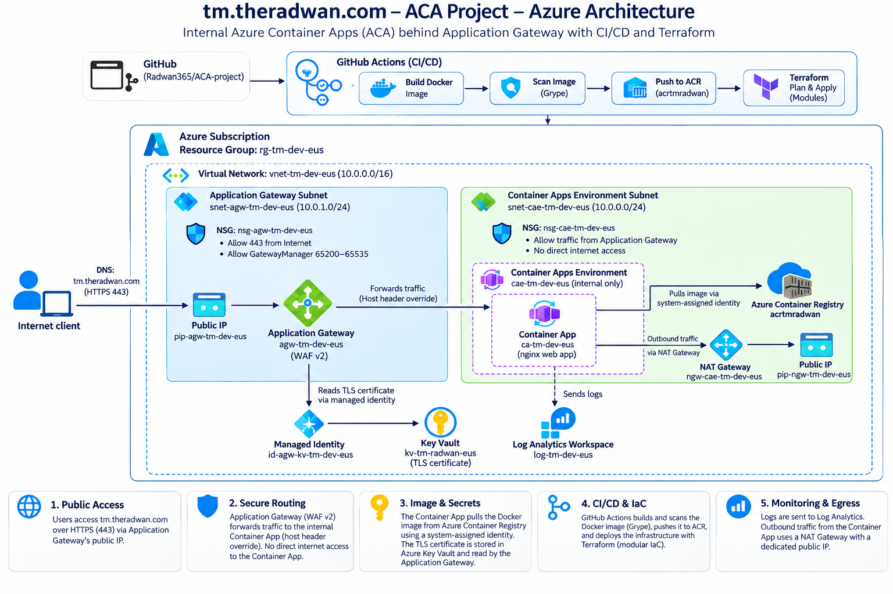

# Threat Composer on Azure Container Apps

A containerised web app deployed to Azure behind HTTPS on a custom domain, with all infrastructure written in Terraform and shipped through GitHub Actions.

**Live URL:** https://tm.theradwan.com (only up while the environment is deployed; it is destroyed between sessions to save cost)

The app is [Threat Composer](https://github.com/awslabs/threat-composer), an open-source threat modelling tool from AWS Labs. The original brief was written for AWS ECS. I adapted it to Azure: built it by hand in the Portal first to understand every component, then tore it down and rebuilt it as code.



## Contents

- [How a request reaches the app](#how-a-request-reaches-the-app)
- [Tech stack](#tech-stack)
- [Repository structure](#repository-structure)
- [CI/CD pipelines](#cicd-pipelines)
- [Design decisions](#design-decisions)
- [Security](#security)
- [Deploying from scratch](#deploying-from-scratch)
- [Running the app locally](#running-the-app-locally)
- [Problems I hit and what I learned](#problems-i-hit-and-what-i-learned)
- [Known limitations and next steps](#known-limitations-and-next-steps)
- [Acknowledgements](#acknowledgements)

## How a request reaches the app

The browser resolves `tm.theradwan.com` through Azure DNS to the Application Gateway's public IP. The gateway terminates TLS using a Let's Encrypt certificate it reads from Key Vault, then forwards the request over HTTPS to the Container App, overriding the host header with the app's internal FQDN.

The Container Apps environment is internal, so it has no public IP of its own and the gateway is the only way in from the internet. The gateway resolves the app's internal FQDN through a private DNS zone that points at the environment's static IP, which is not created automatically when the environment lives in a custom VNet.

Outbound traffic from the app, such as pulling its image from the registry, leaves through a NAT Gateway, because a subnet in Azure no longer gets internet access by default.

## Tech stack

| Area | Tool |
|---|---|
| App | React (Create React App, TypeScript), served by nginx |
| Container | Docker multi-stage build (`node:22-alpine` build stage, non-root `nginx-unprivileged` runtime stage) |
| Compute | Azure Container Apps, internal workload profiles environment |
| Ingress and TLS | Azure Application Gateway Standard_v2, Let's Encrypt certificate in Key Vault |
| Networking | VNet, two subnets, NSGs, NAT Gateway, public and private DNS zones |
| Infrastructure as code | Terraform (`azurerm` 5.x, `vancluever/acme`, `tls`, `time`, `random`) |
| State | Azure Storage backend, Entra ID authentication only |
| CI/CD | GitHub Actions with OIDC federation to Azure |
| Scanning | Grype (container image), Checkov (Terraform) |

## Repository structure

```
.
├── Dockerfile                  # Multi-stage build; build context is ./app
├── app/                        # Threat Composer source, plus nginx.conf for the container
├── infra/
│   ├── bootstrap/              # One-off stack: state storage, GitHub OIDC identity and its roles
│   ├── modules/
│   │   ├── networking/         # VNet, subnets, NSGs, NAT Gateway, public IPs
│   │   ├── container-apps/     # ACR, Log Analytics, environment, Container App, pull identity
│   │   ├── key-vault/          # Key Vault, ACME certificate, App Gateway identity
│   │   ├── app-gateway/        # Application Gateway, listeners, probe, routing, redirect
│   │   └── dns/                # Public A record, private DNS zone for the internal environment
│   ├── backend.tf              # Remote state configuration
│   ├── main.tf                 # Wires the five modules together
│   ├── terraform.tfvars        # Values for the dev environment (no secrets)
│   └── terraform.tfvars.example
└── .github/
    ├── dependabot.yml          # Weekly update PRs for Actions, Docker images and Terraform providers
    └── workflows/
        ├── docker-build.yml    # Build, scan, push, release, smoke test
        ├── deploy.yml          # Terraform: plan on pull requests, apply on main
        └── destroy.yml         # Manual teardown with typed confirmation
```

There are three layers, each with one owner:

| Layer | What it holds | Changed by |
|---|---|---|
| `infra/bootstrap` | State storage, the pipeline's identity and permissions | Applied by hand, once |
| `infra` | The platform: network, environment, registry, gateway, certificate | Terraform workflow |
| The running image | Which version of the app is live | Build and deploy workflow |

Terraform creates the Container App with a public placeholder image and then ignores the running image entirely. The build pipeline owns every release after that. That separation matters: before it, any Terraform run reset the app to whatever image tag happened to be written in the variables file, so an unrelated infrastructure change could silently roll the application back.

## CI/CD pipelines

### `docker-build.yml` — Build and deploy

Runs when `app/` or the `Dockerfile` change.

1. Builds the image from the root `Dockerfile` with `./app` as the build context.
2. Scans the image with Grype and fails on any `high` or `critical` vulnerability. The scan happens before the push, so a vulnerable image never reaches the registry.
3. **Pull requests stop here.**
4. On `main`: logs in to Azure with OIDC and pushes the image to ACR, tagged with the commit SHA.
5. Releases it with `az containerapp update --image`, which creates a new revision running that image.
6. Smoke-tests `https://tm.theradwan.com/health` through the gateway.

If the environment is destroyed, the workflow notices the Container App is missing and skips the push and release with a notice instead of failing.

### `deploy.yml` — Terraform

| Trigger | What happens |
|---|---|
| Pull request touching `infra/` | Format check, validate, Checkov, plan |
| Push to `main` touching `infra/` | The same, then apply |
| Weekly schedule | Apply, so the certificate renews before it expires. Skipped if the environment doesn't exist, so a destroyed environment is never rebuilt by accident |

The apply step runs the exact plan file produced in the same job.

### `destroy.yml` — Terraform destroy

Manual trigger only. The run does nothing unless `tm-dev` is typed as confirmation. It creates a destroy plan first and then applies that plan.

### Authentication

No Azure credentials are stored in GitHub. The workflows request a short-lived token from GitHub's OIDC provider, and Azure trusts that token because of a federated credential on a user-assigned managed identity. The only repository secrets are three identifiers, none of which is a password:

- `AZURE_CLIENT_ID`
- `AZURE_TENANT_ID`
- `AZURE_SUBSCRIPTION_ID`

## Design decisions

| Decision | Why |
|---|---|
| Container Apps instead of AKS | One container. A Kubernetes control plane would add operational weight with no benefit here, and Container Apps bills only for what runs. |
| Application Gateway instead of Front Door | Single-region deployment, so global edge routing solves a problem this project does not have. Reaching an internal Container Apps environment from Front Door also needs the Premium tier and Private Link; the gateway sits directly in the VNet. |
| Internal environment behind the gateway | With external ingress, traffic reaches the app without passing through the subnet's NSG. Making the environment internal leaves one controlled entry point. |
| Key Vault with Azure RBAC | Same permission model as the rest of the project, instead of a second, vault-specific access policy model. |
| Certificate issued by Terraform (ACME provider, DNS-01) | Application Gateway has no free managed certificate. Issuing through Terraform removes the manual export and import the Portal build needed. |
| User-assigned managed identities | The identity exists before the resource that uses it, so its role assignment can be created and given time to propagate first. |
| Placeholder image on first create | Terraform owns the platform, the pipeline owns the release. It also removes a chicken-and-egg problem: the Container App used to need an image in a registry that Terraform had not created yet. |
| Resource group and public DNS zone kept outside the main stack | A `terraform destroy` must not delete the DNS zone, because that would change the name servers delegated at the registrar. |
| Standard_v2 gateway without WAF, autoscale minimum 0, ACR Basic | Cost. WAF was not required by the brief. Every Checkov finding this causes is skipped with a reason written next to the skip. |

## Security

- **No long-lived credentials.** GitHub Actions authenticates with OIDC. The ACR admin user is disabled. Image pulls and certificate reads use managed identities.
- **Least privilege for the pipeline.** The CI identity has `Contributor` on the deployment resource group only. It also needs to create role assignments, so it has `Role Based Access Control Administrator` with a condition restricting it to three roles: `AcrPull`, `Key Vault Secrets User` and `Key Vault Certificates Officer`.
- **Network.** The Container Apps environment has no public IP. The gateway's NSG allows only 443, 80 (redirect to HTTPS) and the `GatewayManager` range Azure requires. The environment's own NSG allows inbound only from the gateway subnet and drops everything else arriving from the VNet.
- **Non-root container.** nginx runs as an unprivileged user on port 8080 and does not advertise its version.
- **TLS.** Predefined policy `AppGwSslPolicy20220101` (TLS 1.2 minimum). HTTP is permanently redirected to HTTPS.
- **Health probe.** The gateway marks the backend healthy only when nginx answers on `/health`, so a broken release shows up as an unhealthy backend rather than a blank page.
- **State storage.** Shared access keys are disabled, so state can only be read through Entra ID. Blob versioning and soft delete are on, public access is off, and `prevent_destroy` guards the storage resources.
- **Scanning.** Grype gates the image, Checkov gates the Terraform.

Two trade-offs worth stating. TLS is terminated at the gateway and re-established to the Container App, which is why the backend settings speak HTTPS on port 443 rather than plain HTTP. And the ACME provider keeps the certificate's private key in Terraform state, which is why the state account is locked down as described above.

## Deploying from scratch

### Prerequisites

- An Azure subscription and permission to create role assignments in it
- A domain you control
- Azure CLI, Terraform 1.9 or later (the pipeline uses 1.12.2), Docker
- A fork or copy of this repository

Names such as the storage account, ACR and Key Vault must be globally unique, so change them from the values in this repo.

### 1. Register the resource providers

The main stack does not register Azure resource providers itself, because the pipeline identity isn't allowed to. Do it once per subscription:

```bash
az login
az provider register --namespace Microsoft.App
az provider register --namespace Microsoft.Insights
```

### 2. Create the resource group and public DNS zone

These two are deliberately not managed by Terraform.

```bash
az group create --name rg-tm-dev-eus --location eastus
az network dns zone create --resource-group rg-tm-dev-eus --name <your-domain>
```

Copy the four name servers from the zone and set them at your domain registrar. Nothing resolves publicly until this delegation is in place, and the certificate cannot be issued either, because Let's Encrypt proves domain ownership through this zone.

### 3. Apply the bootstrap stack

```bash
cd infra/bootstrap
cp terraform.tfvars.example terraform.tfvars   # then edit the values
terraform init
terraform apply
```

`github_repo` must match the repository name exactly, or the pipeline cannot log in.

Add the outputs `AZURE_CLIENT_ID`, `AZURE_TENANT_ID` and `AZURE_SUBSCRIPTION_ID` as GitHub Actions repository secrets.

### 4. Configure the main stack

- In `infra/backend.tf`, set the resource group and storage account to the ones bootstrap created.
- Copy `infra/terraform.tfvars.example` to `infra/terraform.tfvars` and set your own names, domain and email.
- Set `certificate_officer_principal_ids` from the bootstrap outputs `deployer_principal_id` and `github_identity_principal_id`.
- If you change the registry, resource group or Container App names, change them in the `env` block of `.github/workflows/docker-build.yml` too.

### 5. Create the infrastructure

Push to `main` (or merge a pull request) and the Terraform workflow applies it. To run it from your machine instead:

```bash
cd infra
export ARM_SUBSCRIPTION_ID=<subscription-id>
terraform init
terraform apply
```

This takes a while. Application Gateway is slow to provision, and the configuration waits two minutes after the role assignment so it has propagated before the app tries to pull.

At this point the site answers but the gateway reports its backend as unhealthy, because the Container App is still running the placeholder image, which has no `/health` endpoint.

### 6. Deploy the app

Run the **Build and deploy** workflow from the Actions tab (it has a manual trigger). It builds the image, pushes it to the new registry, releases it, and smoke-tests the site. The backend turns healthy once that finishes.

### 7. After that

App changes go out through the Build and deploy workflow, infrastructure changes through the Terraform workflow. To tear everything down, run the **terraform destroy** workflow and type `tm-dev`. After a rebuild, repeat step 6.

## Running the app locally

```bash
docker build -f Dockerfile -t tm:local ./app
docker run --rm -p 8080:8080 tm:local
```

Then open http://localhost:8080. The health endpoint is at http://localhost:8080/health.

## Problems I hit and what I learned

- **The gateway could not find the app.** An internal Container Apps environment in a custom VNet does not register its own DNS. It needs a private DNS zone named exactly after the environment's default domain, linked to the VNet, with a wildcard record pointing at the environment's static IP. In Terraform that is the `dns` module, fed by outputs from `container-apps`.
- **Application Gateway v2 would not finish deploying.** It needs an NSG rule allowing inbound from the `GatewayManager` service tag on ports 65200 to 65535. That is Azure's own control-plane traffic, separate from user traffic.
- **The Container App could not pull its image.** The subnet has no default outbound internet access, so the environment needs an explicit way out. A NAT Gateway on the Container Apps subnet provides it.
- **Ingress scope matters.** The Container App's traffic must be scoped to the VNet, not to the Container Apps environment, or the gateway sitting in a different subnet cannot reach it.
- **Role assignments are not instant.** Creating a role assignment and immediately using it fails intermittently. The `time_sleep` resource and the `depends_on` on module outputs exist to make Terraform wait.
- **The gateway reads certificates as secrets.** The identity needs `Key Vault Secrets User`, not a certificate role, because Application Gateway fetches the certificate through the Secrets API.
- **`Contributor` cannot assign roles.** The pipeline failed on the first role assignment until the CI identity was given a constrained `Role Based Access Control Administrator` role.
- **An infrastructure run could roll the app back.** When Terraform owned the image tag, any Terraform run reset the app to the tag written in the variables file, even when the change had nothing to do with the app. Hence the `lifecycle` block and the pipeline-owned release.
- **Non-root nginx cannot bind port 80.** The container listens on 8080, which is what the Container App's ingress targets.
- **A single-page app needs a fallback route.** Without `try_files ... /index.html`, refreshing any page other than the home page returns a 404 from nginx.
- **Translating the brief.** The assignment was written for AWS, and several of its commands and concepts have no direct Azure equivalent. Working out the Azure version of each piece was a large part of the learning.

## Known limitations and next steps

- [ ] Protect `main` with required reviews and add an approval step before `terraform apply`
- [ ] Pin images by digest and sign them
- [ ] End-to-end TLS with a certificate the Container App presents itself, rather than the platform certificate
- [ ] Alerts on the Application Gateway's unhealthy-host metric
- [ ] Manage the resource group and DNS zone from the bootstrap stack so step 2 isn't manual
- [ ] Multi-region, if the project ever needs Front Door rather than Application Gateway

## Acknowledgements

- [Threat Composer](https://github.com/awslabs/threat-composer) by AWS Labs, licensed under Apache-2.0. See `NOTICE` and `app/LICENSE`.
- CoderCo for the original project brief.
